# ficciones

One person's computer, as a repository: the installer, the desktop, the dotfiles and the agent
wiring, declared in one place so the machine can be rebuilt on any box or in a throwaway VM and
come back the same. Named after Borges' *Ficciones*, a collection of stories; this is a collection
of modules. The programs it runs that are repos of their own, like [menard](https://github.com/lessthanseventy/menard)
(Elixir editing for agents), are pinned here by path and wired in, not vendored.

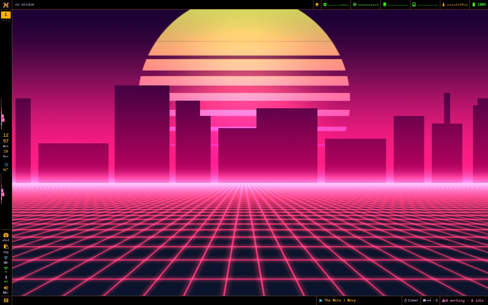

## What's in it

- **A Hyprland desktop** on a minimal Arch base, with Hyprland itself built from the flake.
- **An astal shell** (AGS 3, GTK4) that draws the rail, bar, deck, launcher, dashboard, settings,
  notifications, OSD and lock, all in layers rather than windows.
- **Four palettes, one theme.** Every surface on the machine is generated from one palette file,
  and every colour pair is held to WCAG AAA.
- **Agent wiring.** The rules every coding agent here works by, its skills and mods.
- **One loop.** Every command a human or an agent runs is a mise task, and `mise run check` is
  the gate.

## The shell

The shell lives in `modules/desktop/shell`. The rail, bar and deck are always up; everything else
opens on a key and on the monitor under the pointer. Each surface is one file in `surfaces/`, and
each dashboard pane is one file in `panes/`.

<table>
<tr>
<td width="50%">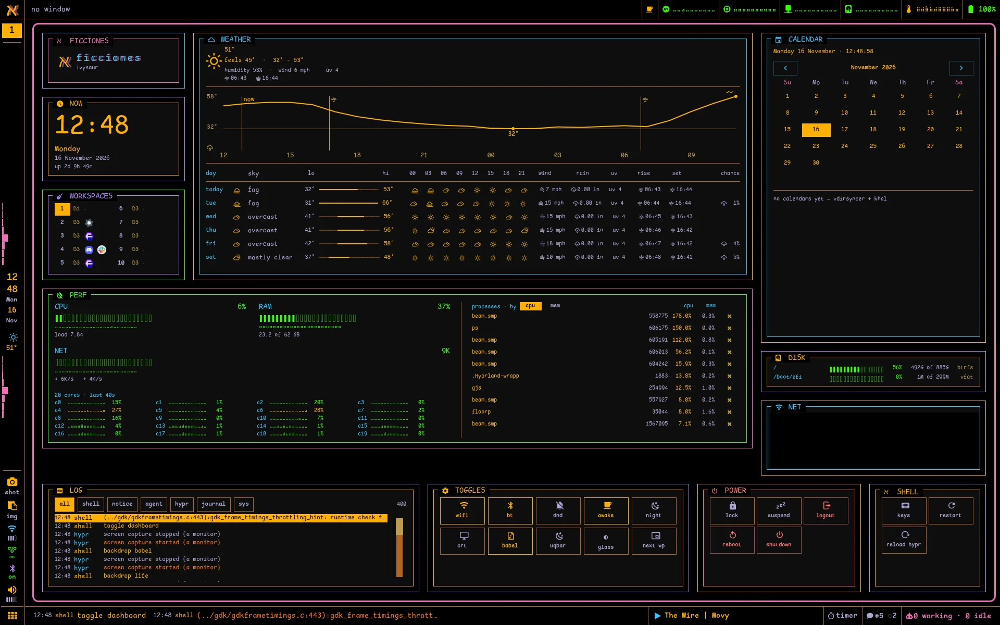<br><b>Dashboard</b> <code>Super+D</code>: weather, calendar, perf, disk, net, the log, toggles and power. (The network panel's details are blacked out here.)</td>
<td width="50%">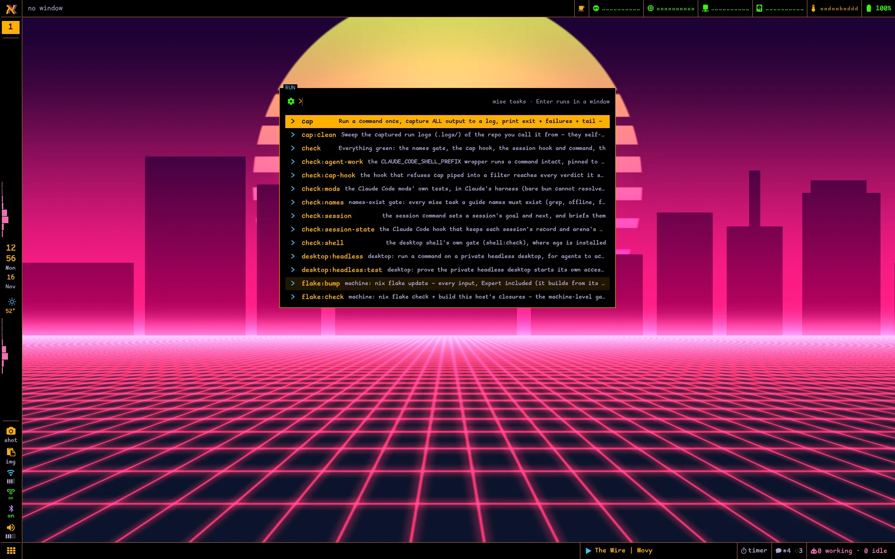<br><b>Launcher</b> <code>Super+Space</code>: apps, <code>=</code> calc, <code>/</code> files, <code>:</code> shell, and <code>&gt;</code> verbs, which are the mise tasks.</td>
</tr>
<tr>
<td>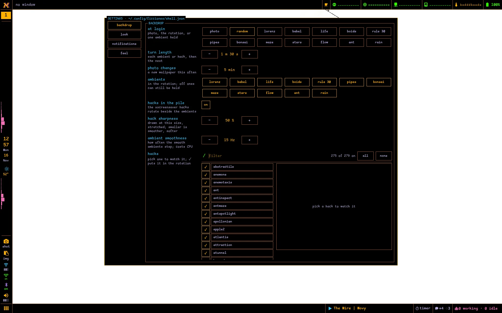<br><b>Settings</b> <code>Super+,</code>: backdrop, look, notifications and feel (dwell, grace, hot edge).</td>
<td>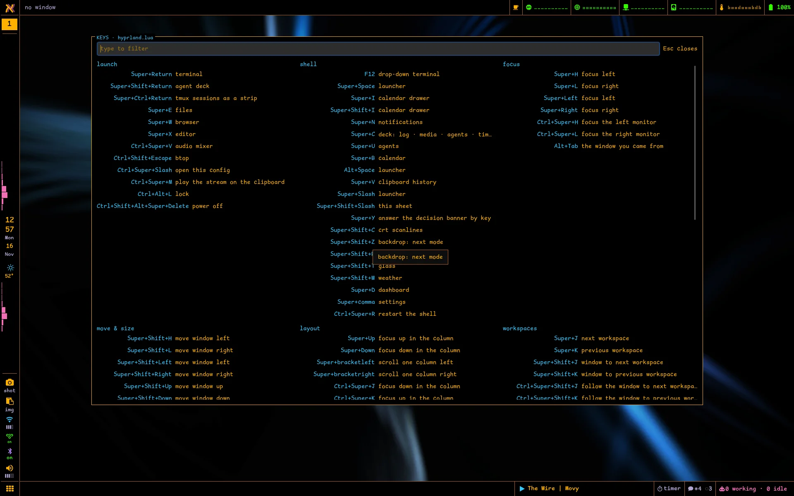<br><b>Cheatsheet</b>: every bind, read live from the compositor, with a filter.</td>
</tr>
<tr>
<td>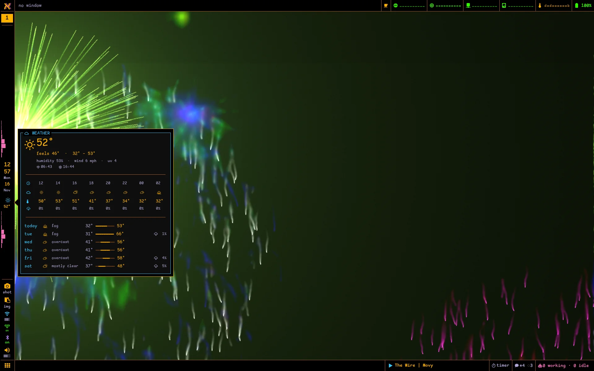<br><b>Weather</b>: a popover from the rail; the calendar, volume and network are the same.</td>
</tr>
</table>

The backdrop rotates through photos, the shell's own text-grid modes (the Library of Babel, life,
a Lorenz attractor, a bonsai) and the whole pile of classic xscreensaver hacks, each run on a
rootful Xwayland made into the monitor's background layer (`xss-host`, in
`modules/desktop/default.nix`). Settings picks which hacks are in the pile, with a live preview.
The shots above sit on synthwavecity, substrate, flurry, cityflow and fireworkx; a few more:

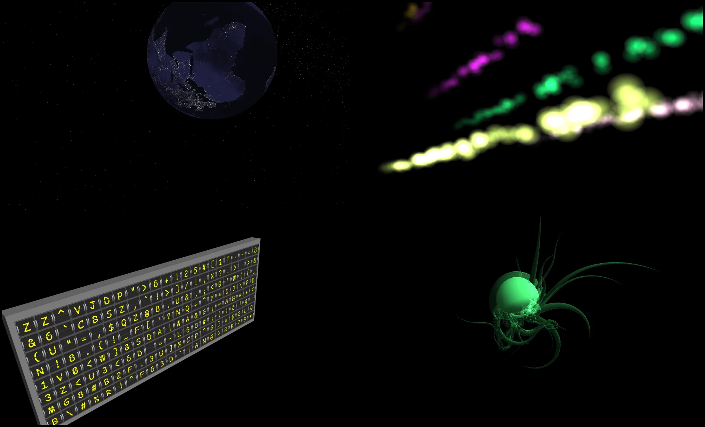

[`docs/manual/surfaces.md`](docs/manual/surfaces.md) says what the wheel, hover and click do on each
cell; [`docs/manual/keys.md`](docs/manual/keys.md) lists every bind.

## The palettes

Four palettes, one theme: every surface (terminal, prompt, TUIs, shell, browser chrome, GTK and
Qt, Neovim, Claude Code and the lock screen) is generated from
`modules/desktop/theme/palettes/<name>.nix` by `render.nix`, and nothing else on the machine
carries a hex value. `mise run theme:contrast` holds each against the WCAG floors: 7:1 for text,
3:1 for bands, in every palette.

The law is short. Body text is amber on black (uqbar) or its light twin. An amber field is the
**cursor**, where you are; a violet field is the **selection**, what you picked and left behind.
Green is live, pink is agents and attention, red is alarm. `Super+Shift+P` flips within a pair.
The full role table is [`docs/manual/palette.md`](docs/manual/palette.md).

The lock screen in each palette, photographed in a nested compositor by `mise run hyprlock:preview`:

<table>
<tr>
<td>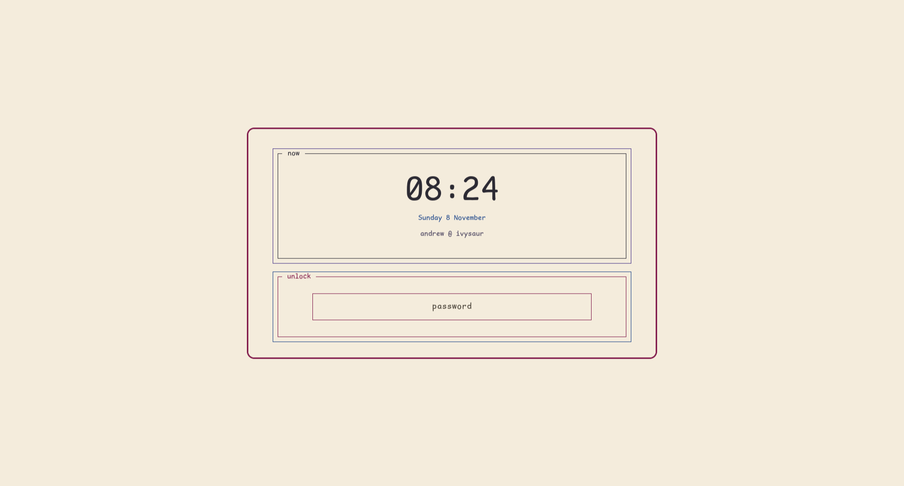<br><b>babel</b>: graphite on notebook paper</td>
<td>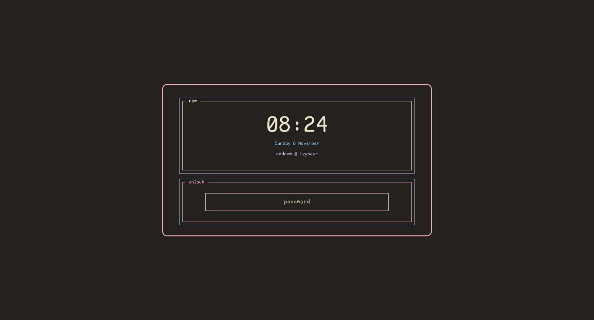<br><b>hronir</b>: chalk on charcoal</td>
</tr>
<tr>
<td>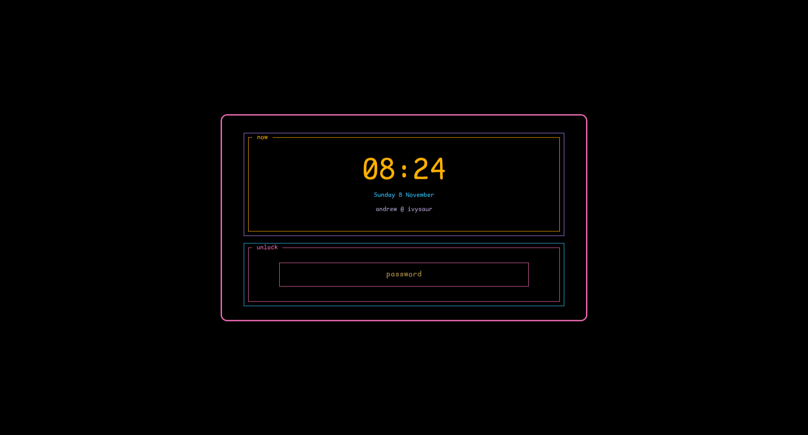<br><b>uqbar</b>: amber on black</td>
<td>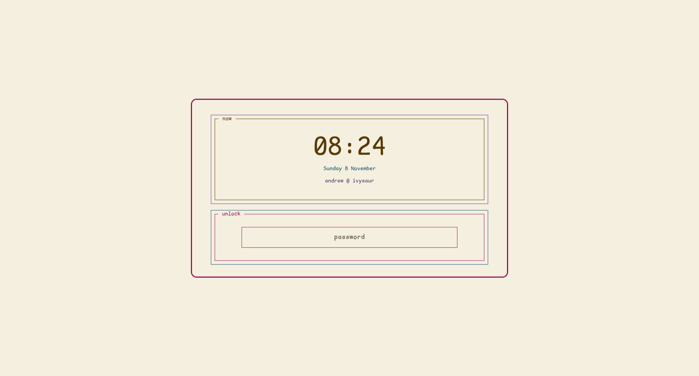<br><b>zahir</b>: dark amber on cream</td>
</tr>
</table>

One font everywhere: ComicShannsMono Nerd Font, sizes biased up.

## The machine

Two targets, one flake:

- `homeConfigurations.personalbox`: home-manager on the Arch box. Arch keeps what has to match the
  kernel or run as root (kernel, nvidia, mesa, ly, PAM); Hyprland and the rest of its stack come
  from here.
- `homeConfigurations.anmoore`: the work Mac. The same palettes on terminals, prompt, TUIs,
  Floorp and Claude Code, and no desktop.

A switch applies one commit: every file it installs is in the nix store, none links back into
this working tree (the flake's `home-links` check holds it), so a checkout or an edit changes
nothing live until the next `home:switch`.

### Bringing it up

On a minimal Arch install with `nix` from pacman and `mise`:

```sh
git clone https://github.com/lessthanseventy/ficciones ~/projects/ficciones
cd ~/projects/ficciones
mise run hyprland:install   # once, sudo: the flake's mesa for /run/opengl-driver, a ly session for Hyprland
mise run keyd:install       # once, sudo: the keyboard remap
mise run home:switch        # the profile; afterwards, `mise run machine:update` applies a checkout
```

On the Mac it is `mise run home:switch:mac`. Machine secrets are agenix files in `secrets/`, so a
new box needs its key added to `secrets/secrets.nix` before they decrypt.

## Layout

```
ficciones/
  flake.nix              # the machine: home-manager for the Arch box and the Mac
  mise.toml, tasks/      # the dev loop: every verb a human or an agent runs; `mise tasks` lists them
  scripts/               # the shell side of the loop: cap, watch, the manual and theme generators, the git hooks
  modules/
    os/                  # the dotfiles the profiles share: zshrc, gitconfig, gitignore, Hyprland's patches
    arch/                # the system half of the desktop, for home-manager on the Arch base
    desktop/             # the Hyprland stack: its config, the astal shell, the theme and its four palettes
    mac/                 # the work Mac: the palette's portable surfaces, no desktop
    agents/              # the rules, skills, mods and shell every agent on this machine works by
    menard-host.nix      # what menard needs on a host: mise, Expert, the formatters its write check runs
    tmux.nix, hyprland-packages.nix
  secrets/               # agenix-encrypted machine secrets
  docs/
    manual/              # how to drive the machine; keys, tasks and palette generated from their sources
    plans/               # design records, dated
    research/, reviews/, dogfood/
```

## The loop

Every command a human or an agent runs is a mise task, in `tasks/<group>.toml`; `mise tasks`
lists them and `docs/manual/tasks.md` is generated from that list.

- `mise run check`: every `check:*` task, the manual's drift check and the flake.
  Green before a commit.
- `mise run flake:check`: evaluate and build this host's closures, the machine-level gate.
- `mise run home:switch` (`home:switch:mac` on the Mac): apply the home-manager profile. The
  human's to run: building the machine is a change the human owns.
- `mise run machine:update`: the one update verb. `home:switch`, then restart the shell.
- `mise run manual:gen` and `manual:check`: regenerate the manual's pages from their sources, and
  fail when one has drifted.
- `mise run cap -- CMD`: run a command once, log all of it, print its exit, failures and tail.
- `mise run shot:layer -- bar` and its siblings `shot:monitor`, `shot:window`, `shot:region`: the
  screenshots above, and how a shell change is checked.
- `mise run hypr:check`: load `hyprland.lua` in a nested Hyprland and diff it against the live
  one, because saving the real file reloads the live compositor.

## Agents

`modules/agents/how-to-work.md` is installed as `~/.claude/CLAUDE.md`: the four rules and the code
standards every agent on this machine works by. Beside it live the skills (`agent-browser`,
`agent-desktop`, `brief`, `goal`), the mods (`changes-pane`, `review-pane`, `transcript-rows`, `inline-image`) and
the agents' zsh. Each repo adds its own law in `AGENTS.md`; this one's is at the root.

## Where to start reading

- `AGENTS.md`: the boundaries for a session at the repo root, and the loop.
- `docs/manual/README.md`: the operator's manual.
- `docs/plans/2026-08-14-machine-v2-and-funes-design.md`: the machine-level design and the
  decisions behind it; `docs/plans/2026-09-17-ficciones-master-plan.md`: the plan.
