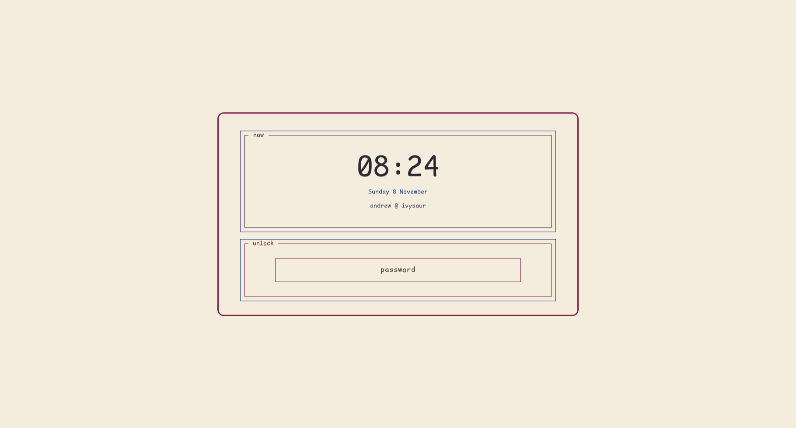
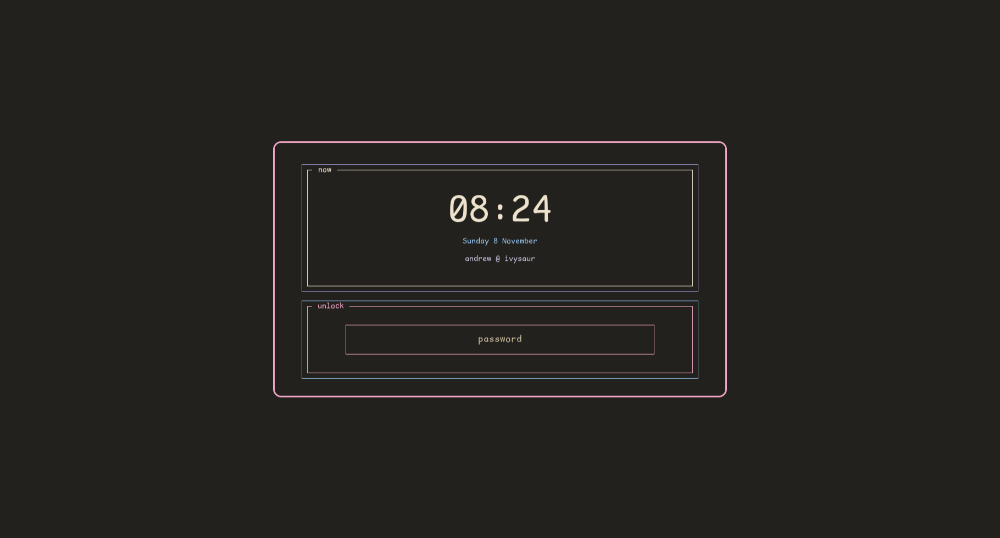
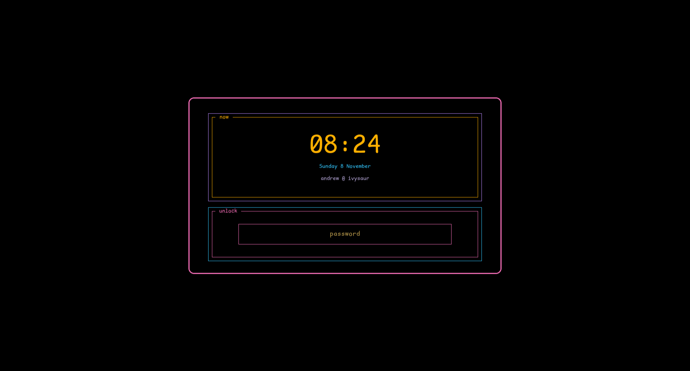
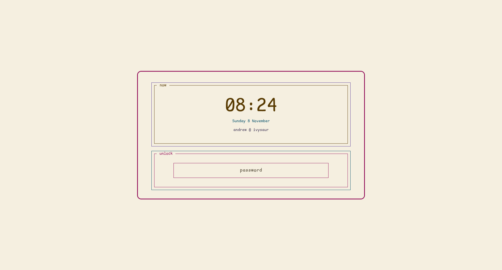

# ficciones

One person's computer, as a repository: the installer, the desktop, the dotfiles and the agent
wiring, declared in one place so the machine can be rebuilt on any box or in a throwaway VM and
come back the same. Named after Borges' *Ficciones*, a collection of stories; this is a collection
of modules. The programs it runs that are repos of their own, [tlon](https://github.com/lessthanseventy/tlon)
(the AI office: server, TUI and Claude Code adapters) and [menard](https://github.com/lessthanseventy/menard)
(Elixir editing for agents), are pinned here by path and wired in, not vendored.

## Layout

```
ficciones/
  flake.nix              # the machine: NixOS for the VM and the laptop, home-manager for the Arch box and the Mac
  mise.toml, tasks/      # the dev loop: every verb a human or an agent runs; `mise tasks` lists them
  scripts/               # the shell side of the loop: cap, watch, the manual and theme generators, the git hooks
  modules/
    os/                  # the NixOS side: one user, Hyprland, sound, network, fonts; vm.nix and ivysaur.nix add the hardware
    arch/                # what modules/os gives a NixOS host, for home-manager on the Arch base
    desktop/             # the Hyprland stack: its config, the astal shell, the theme and its four palettes
    mac/                 # the work Mac: the palette's portable surfaces, no desktop
    agents/              # the rules, skills, mods and shell every agent on this machine works by
    menard-host.nix      # what menard needs on a host: mise, Expert, the formatters its write check runs
    tmux.nix, hyprland-packages.nix
  secrets/               # agenix-encrypted machine secrets
  docs/
    manual/              # how to drive the machine; keys, tasks and palette generated from their sources
    plans/               # design records, dated
    research/, reviews/, dogfood/
```

## The machine

Four targets, one flake:

- `homeConfigurations.personalbox`: home-manager on the Arch box. Arch keeps what has to match the
  kernel or run as root (kernel, nvidia, mesa, ly, PAM); Hyprland and the rest of its stack come
  from here.
- `homeConfigurations.anmoore`: the work Mac. The same palettes on terminals, prompt, TUIs,
  Floorp and Claude Code, and no desktop.
- `nixosConfigurations.vm`: a disposable NixOS VM (`mise run vm:build`, `vm:run`, `vm:ssh`) where
  full NixOS is tried before it touches metal.
- `nixosConfigurations.ivysaur`: the laptop, full NixOS.

home-manager places symlinks that point back into this working tree for the desktop's config, so
an edit to `modules/desktop/hypr/hyprland.lua` is live on `hyprctl reload`. The price is that a
checkout is a desktop change, which the hooks in `scripts/git-hooks` cover.

## The palettes

Four palettes, one theme: every surface, terminal, prompt, TUI, browser chrome and lock screen is
generated from `modules/desktop/theme/palettes/<name>.nix`, and `mise run theme:contrast` holds
each against the WCAG floors. The lock screen, photographed in a nested compositor by
`mise run hyprlock:preview`:

<table>
<tr>
<td></td>
<td></td>
</tr>
<tr>
<td></td>
<td></td>
</tr>
</table>

## The loop

Every command a human or an agent runs is a mise task, in `tasks/<group>.toml`; `mise tasks`
lists them and `docs/manual/tasks.md` is generated from that list.

- `mise run check`: the names gate, the cap hook's test, the mods' tests, the desktop shell's gate, the manual's drift check and the flake.
  Green before a commit.
- `mise run flake:check`: evaluate and build this host's closures, the machine-level gate.
- `mise run home:switch` (`home:switch:mac` on the Mac): apply the home-manager profile. The
  human's to run: building the machine is a change the human owns.
- `mise run machine:update`: the one update verb. `home:switch`, then restart the shell and tlon's
  server.
- `mise run manual:gen` and `manual:check`: regenerate the manual's pages from their sources, and
  fail when one has drifted.
- `mise run cap -- CMD`: run a command once, log all of it, print its exit, failures and tail.

## Agents

`modules/agents/how-to-work.md` is installed as `~/.claude/CLAUDE.md`: the four rules and the code
standards every agent on this machine works by. Beside it live the skills (`agent-browser`,
`agent-desktop`), the mods (`changes-pane`, `review-pane`, `transcript-rows`) and the agents' zsh. Each repo adds its own law in
`AGENTS.md`; this one's is at the root.

## Where to start reading

- `AGENTS.md`: the boundaries for a session at the repo root, and the loop.
- `docs/manual/README.md`: the operator's manual.
- `docs/plans/2026-08-14-machine-v2-and-funes-design.md`: the machine-level design and the
  decisions behind it; `docs/plans/2026-09-17-ficciones-master-plan.md`: the plan.
